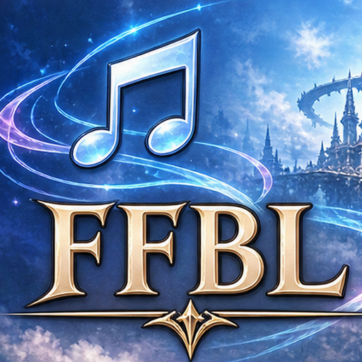
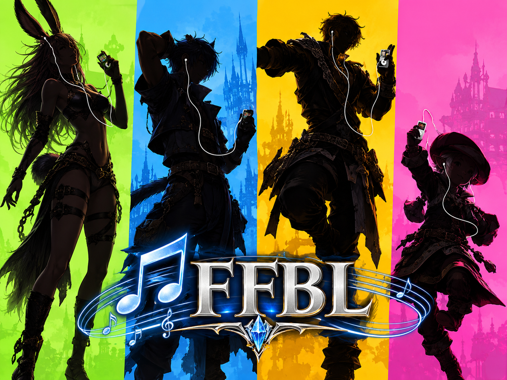

<div align="center">



# FFBL

**Der Lautsprecher deiner RP-Gruppe, direkt in Final Fantasy XIV.**

[🇧🇷 Português](README.md) · [🇺🇸 English](README.en.md) · [🇯🇵 日本語](README.ja.md) · **🇩🇪 Deutsch** · [🇫🇷 Français](README.fr.md)




</div>

---

## 🎵 Was ist FFBL?

**FFBL** (eine liebevolle Anspielung auf „JBL“) macht aus deinem Discord-Sprachkanal einen **gemeinsamen Lautsprecher**. Jeder in der Gruppe kann **Lieder wünschen, überspringen und pausieren, ohne das Spiel zu verlassen**, über einen **iPod** auf dem Bildschirm. Die Musik hört jeder im Sprachkanal.

### 🎭 Für RP, mit Vanilla- und Mod-Spielern

| Wer | Erlebnis |
|---|---|
| 🎧 **Vanilla-Spieler** (ohne Plugins) | Betritt einfach den Discord-Sprachkanal und **hört die Musik**. Nichts zu installieren. |
| 🛠️ **Spieler mit FFBL** | Hat den **iPod im Spiel**: Wünschen, Überspringen, Pause, Lautstärke, **aktuelles Lied** und **Warteschlange**. |
| 📺 **FFBL + Penumbra** | Sieht zusätzlich die **Leinwand**, einen echten Bildschirm in der Szenerie (ein umgestalteter *Plush Cushion*-Minion) mit Cover oder eigenem Bild. |

## ✨ Funktionen

- 📱 **iPod im Spiel** mit Click-Wheel: ⏮ ⏭ ⏯, Lautstärke, Playlist.
- 💬 **Wünsche unter dem Namen deines Charakters**: Was du wünschst, erscheint im Discord-Raum mit dem Namen deines Charakters.
- 🎶 **Gemeinsame Warteschlange**: per Name oder YouTube-Link.
- 📺 **Leinwand in der Szenerie**: Standardbild, aktuelles Cover oder eigenes Bild; Größe, Position und Drehung einstellbar.
- 🌍 **Português, English, 日本語, Deutsch, Français.**
- 🔌 **OMNE enthalten** (Näheschat, siehe unten).

## 🗣️ Was ist OMNE?

**OMNE** (*Olá, Meu Nome É*) ist der Teil von FFBL, der **Nähe-Sprachchat über einen Discord-Sprachkanal** ermöglicht: Je näher ein Charakter an deinem ist, **desto lauter hörst du die Person**; entfernt er sich, wird die Stimme leiser.

1. Alle betreten denselben Discord-Sprachkanal.
2. Du sagst dem Plugin, welcher Charakter welche Person ist (Schaltflächen **Ich** und **Ziel** helfen).
3. Fünfmal pro Sekunde misst das Plugin die Entfernung der Charaktere und passt die Lautstärke jeder Person **in deinem Discord** an.
4. Nah = volle Lautstärke. Fern = Stille. Die Distanzen stellst du selbst ein.

**Ist das sicher?** OMNE **nimmt kein Audio auf und sendet keines**. Es spricht nur mit der Discord-App auf deinem eigenen PC und ändert die Lautstärke. Es gibt keinen OMNE-Server.

> ℹ️ OMNE ist standardmäßig **aus** (Reiter **OMNE**, Kästchen „OMNE aktivieren“).
> Die Lautstärkesteuerung von Discord ist eingeschränkt: Sie funktioniert nur für als *App-Tester* eingetragene Personen (max. 50 pro App).

## 🚀 Ich will es nutzen! (Spieler)

👉 **[Spieleranleitung](docs/usuarios.de.md)**

Kurzfassung: In Dalamud `/xlsettings` → **Experimental** → **Benutzerdefinierte Plugin-Repositories**, diese URL einfügen und FFBL installieren:

```
https://raw.githubusercontent.com/yurammaruy/FFBL/main/repo.json
```

Der Organisator gibt dir einen **Verbindungscode** (beginnt mit `FFBL1-`). Füge ihn in FFBL ein, und alles wird automatisch ausgefüllt.

## 🏠 Ich will meinen eigenen Raum aufbauen! (Kanalbesitzer)

👉 **[Anleitung für Kanalbesitzer](docs/donos.de.md)**: Discord einrichten → Musikbot starten → Daten an die Gruppe weitergeben.

## ⚠️ Wichtige Hinweise

- Dalamud-Plugins werden **nicht von Square Enix unterstützt**. Nutzung auf eigene Gefahr.
- Der **Webhook-Link ist wie ein Passwort**: nur mit deiner Gruppe teilen.
- Die Leinwand benötigt das Plugin **Penumbra** und den Minion **Plush Cushion**.
- Bildschirmübertragung per Discord ist nicht möglich; die Leinwand zeigt Bilder, der Ton kommt über den Sprachkanal.

## 🤝 Mitmachen & Lizenz

**Open Source** ([MIT](LICENSE)). Vorschläge, Korrekturen und Übersetzungen sind über **Issues** und **Pull Requests** willkommen.

Die Leinwand nutzt den Mod **Background Screen** von **Anya Hichu** (mit Namensnennung in `penumbra/` enthalten).

Von **Lusmar**, mit Liebe für die RP-Community von Eorzea. 💙
