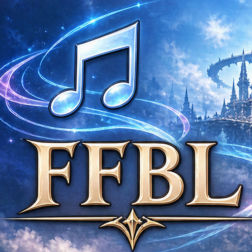
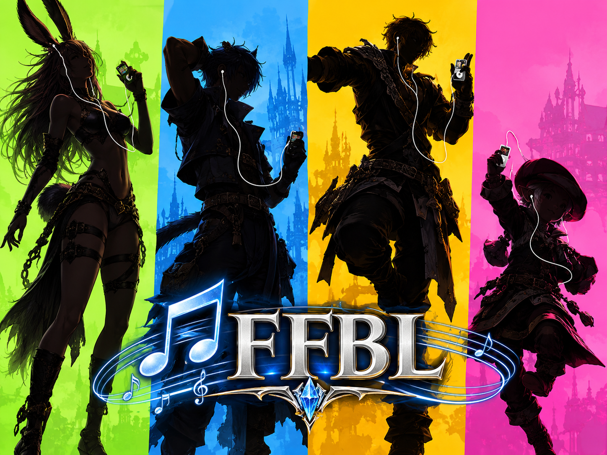

<div align="center">



# FFBL

**Your RP group's speaker, inside Final Fantasy XIV.**

[🇧🇷 Português](README.md) · **🇺🇸 English** · [🇯🇵 日本語](README.ja.md) · [🇩🇪 Deutsch](README.de.md) · [🇫🇷 Français](README.fr.md)




</div>

---

## 🎵 What is FFBL?

**FFBL** (a playful take on "JBL") turns your Discord voice room into a **shared speaker**. Anyone in the group can **request, skip and pause songs without leaving the game** through an on-screen **iPod**, and the music plays for everyone in the voice room.

### 🎭 Made for RP, with vanilla and modded players

| Who | Experience |
|---|---|
| 🎧 **Vanilla player** (no plugins) | Just joins the Discord voice room and **hears the music**. Nothing to install. |
| 🛠️ **Player with FFBL** | Gets the **in-game iPod**: request, skip, pause, volume, **room chat** and **queue**. |
| 📺 **FFBL + Penumbra** | Also sees the **screen**, a real display in the scenery (it re-skins your *Plush Cushion* minion) showing the album art or your own image. |

## ✨ Features

- 📱 **In-game iPod** with click wheel: ⏮ ⏭ ⏯, volume, playlist.
- 💬 **Discord room chat** in-game, using your character name.
- 🎶 **Shared queue**: request by name or YouTube link.
- 📺 **Screen in the scenery**: default image, current cover or your own image; adjustable size, position and rotation.
- 🌍 **Português, English, 日本語, Deutsch, Français.**
- 🔌 **OMNE included** (proximity voice, in testing, see below).

## 🗣️ What is OMNE?

**OMNE** is the part of FFBL that creates **proximity voice using a Discord voice room**: the closer a character is to yours, the **louder you hear that person**; as they walk away, the voice fades.

1. Everyone joins the same Discord voice room.
2. You tell the plugin which character is which person (**Me** and **Target** buttons help).
3. Five times per second the plugin measures the distance between characters in game and adjusts each person's volume **in your Discord**.
4. Close = full volume. Far = silence. You choose the distances.

**Is it safe?** OMNE **does not record, capture or send audio**. It only talks to the Discord app on your own PC and changes each person's volume. There is no OMNE server.

> ⚠️ **OMNE is still in development and may have bugs. It is disabled by default** (plugin **OMNE** tab, "Enable OMNE" checkbox).
> Discord's volume control is a restricted feature: it only works for people added as *app testers* (limit of 50 per app).

## 🚀 I want to use it! (players)

👉 **[Player guide](docs/usuarios.en.md)**

Quick version: in Dalamud, `/xlsettings` → **Experimental** → **Custom Plugin Repositories**, paste this URL and install FFBL:

```
https://raw.githubusercontent.com/yurammaruy/FFBL/main/repo.json
```

The group organizer will give you a **Client ID**, a **Client Secret** and a **webhook link**.

## 🏠 I want to set up my own room! (channel owners)

👉 **[Channel owner guide](docs/donos.en.md)**: configure Discord → run the music bot → share the details with your group.

## ⚠️ Important notes

- FFBL is **in testing** and may have bugs.
- Dalamud plugins are **not supported by Square Enix**. Use at your own risk.
- The **webhook link is like a password**: share it only with your group.
- The screen needs the **Penumbra** plugin and the **Plush Cushion** minion.
- Screen-sharing the display over Discord is not possible, so the screen shows images and the sound comes through the voice room.

## 🤝 Contributing & license

**Open source** ([MIT](LICENSE)). Suggestions, fixes and translations are welcome via **Issues** and **Pull Requests**.

Made by **Lusmar**, with love for the Eorzea RP community. 💙
