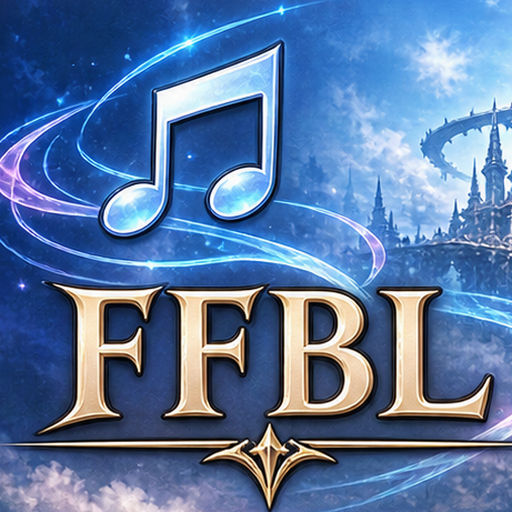
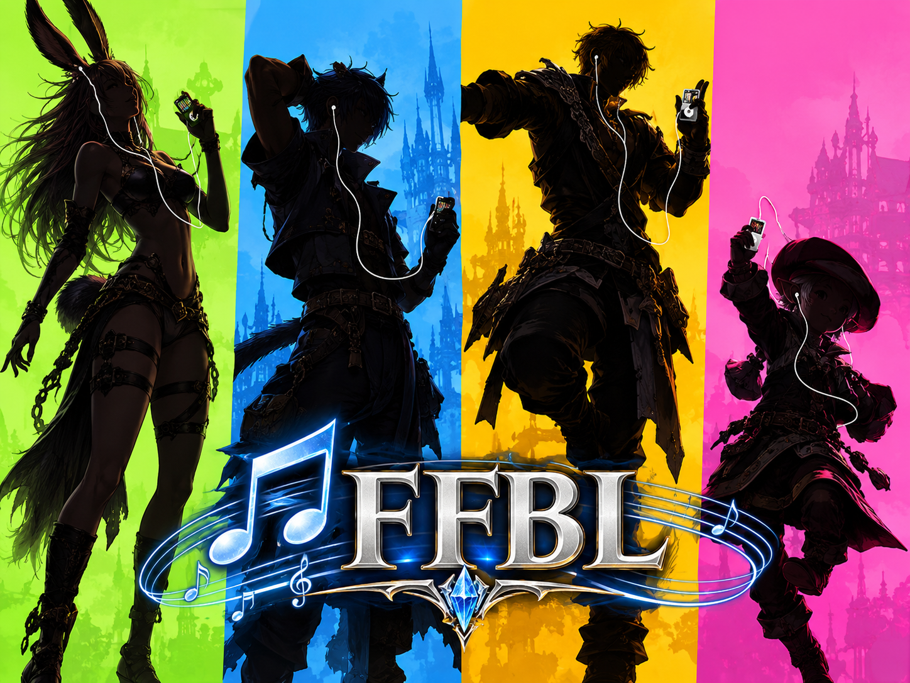

<div align="center">



# FFBL

**La enceinte de votre groupe RP, directement dans Final Fantasy XIV.**

[🇧🇷 Português](README.md) · [🇺🇸 English](README.en.md) · [🇯🇵 日本語](README.ja.md) · [🇩🇪 Deutsch](README.de.md) · **🇫🇷 Français**




</div>

---

## 🎵 Qu'est-ce que FFBL ?

**FFBL** (clin d'œil à « JBL ») transforme votre salon vocal Discord en **enceinte partagée**. Chaque membre du groupe peut **demander, passer et mettre en pause des morceaux sans quitter le jeu**, grâce à un **iPod** affiché à l'écran. La musique est diffusée pour tout le salon vocal.

### 🎭 Pensé pour le RP, avec joueurs vanilla et joueurs moddés

| Qui | Expérience |
|---|---|
| 🎧 **Joueur vanilla** (sans plugin) | Rejoint le salon vocal Discord et **écoute la musique**. Rien à installer. |
| 🛠️ **Joueur avec FFBL** | A l'**iPod en jeu** : demandes, passer, pause, volume, **morceau en cours** et **file d'attente**. |
| 📺 **FFBL + Penumbra** | Voit aussi l'**écran**, un vrai écran dans le décor (votre mascotte *Plush Cushion* rhabillée) affichant la pochette ou votre image. |

## ✨ Fonctionnalités

- 📱 **iPod en jeu** avec molette : ⏮ ⏭ ⏯, volume, playlist.
- 💬 **Demandes au nom de votre personnage** : ce que vous demandez apparaît dans le salon Discord avec le nom de votre personnage.
- 🎶 **File partagée** : par nom ou lien YouTube.
- 📺 **Écran dans le décor** : image par défaut, pochette en cours ou votre image ; taille, position et rotation réglables.
- 🌍 **Português, English, 日本語, Deutsch, Français.**
- 🔌 **OMNE inclus** (voix de proximité, en test, voir ci-dessous).

## 🗣️ Qu'est-ce que OMNE ?

**OMNE** est la partie de FFBL qui crée une **voix de proximité grâce à un salon vocal Discord** : plus un personnage est proche du vôtre, **plus vous l'entendez fort** ; en s'éloignant, la voix s'estompe.

1. Tout le monde rejoint le même salon vocal Discord.
2. Vous indiquez au plugin quel personnage correspond à quelle personne (boutons **Moi** et **Cible**).
3. Cinq fois par seconde, le plugin mesure la distance entre les personnages et règle le volume de chacun **dans votre Discord**.
4. Proche = volume plein. Loin = silence. Vous choisissez les distances.

**Est-ce sûr ?** OMNE **n'enregistre, ne capture et n'envoie aucun audio**. Il dialogue uniquement avec l'application Discord de votre PC pour changer les volumes. Il n'existe aucun serveur OMNE.

> ⚠️ **OMNE est encore en développement et peut présenter des défauts. Il est désactivé par défaut** (onglet **OMNE**, case « Activer OMNE »).
> Le contrôle du volume de Discord est restreint : il ne fonctionne que pour les personnes ajoutées comme *testeurs de l'app* (50 maximum par app).

## 🚀 Je veux l'utiliser ! (joueurs)

👉 **[Guide du joueur](docs/usuarios.fr.md)**

En bref : dans Dalamud, `/xlsettings` → **Experimental** → **Dépôts de plugins personnalisés**, collez cette adresse et installez FFBL :

```
https://raw.githubusercontent.com/yurammaruy/FFBL/main/repo.json
```

L'organisateur vous donnera un **Client ID**, un **Client Secret** et un **lien webhook**.

## 🏠 Je veux monter mon propre salon ! (propriétaires)

👉 **[Guide du propriétaire](docs/donos.fr.md)** : configurer Discord → lancer le bot musical → transmettre les infos au groupe.

## ⚠️ Remarques importantes

- FFBL est **en phase de test** et peut contenir des défauts.
- Les plugins Dalamud **ne sont pas soutenus par Square Enix**. Utilisation à vos risques.
- Le **lien webhook est comme un mot de passe** : ne le partagez qu'avec votre groupe.
- L'écran nécessite le plugin **Penumbra** et la mascotte **Plush Cushion**.
- Le partage d'écran via Discord n'est pas possible ; l'écran affiche des images et le son passe par le salon vocal.

## 🤝 Contribuer & licence

Projet **open source** ([MIT](LICENSE)). Suggestions, corrections et traductions bienvenues via **Issues** et **Pull Requests**.

Réalisé par **Lusmar**, avec amour pour la communauté RP d'Éorzéa. 💙
