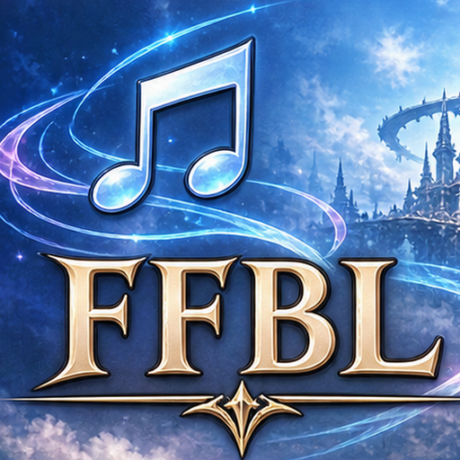
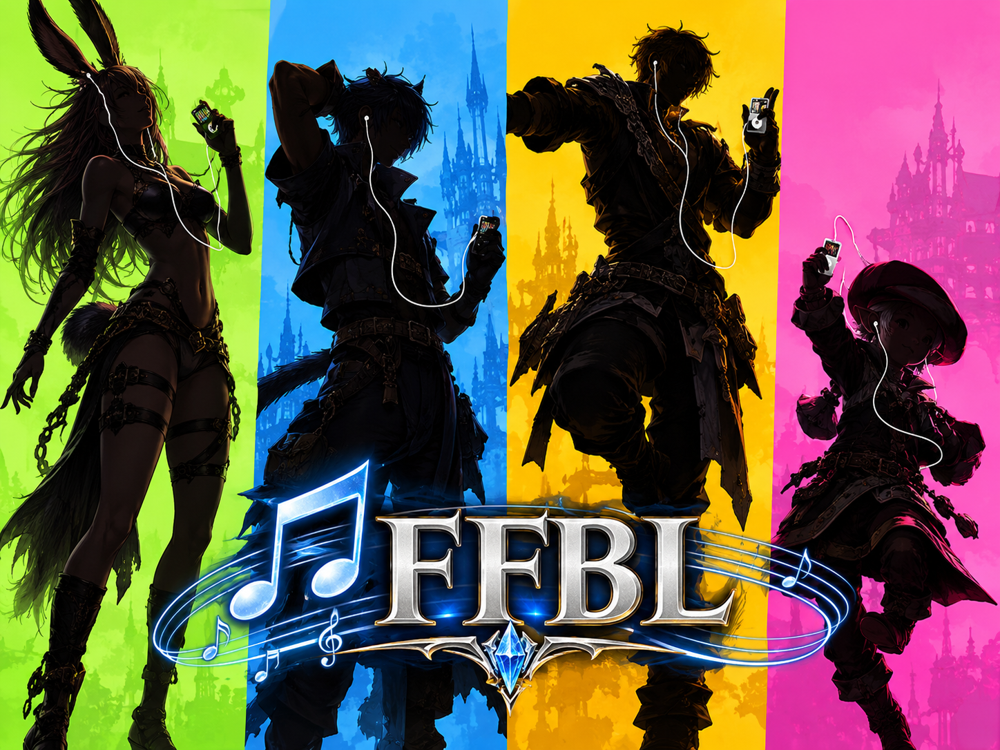

<div align="center">



# FFBL

**あなたのRP仲間のスピーカーを、ファイナルファンタジーXIVの中に。**

[🇧🇷 Português](README.md) · [🇺🇸 English](README.en.md) · **🇯🇵 日本語** · [🇩🇪 Deutsch](README.de.md) · [🇫🇷 Français](README.fr.md)




</div>

---

## 🎵 FFBLとは？

**FFBL**（「JBL」へのちょっとしたオマージュ）は、DiscordのボイスルームをRP仲間の**共有スピーカー**に変えます。画面上の**iPod**から、**ゲームを離れずに**曲のリクエスト・スキップ・一時停止ができ、ボイスルームの全員に音楽が流れます。

### 🎭 バニラ（MODなし）の人もMODありの人も楽しめるRP向け

| 誰が | 体験 |
|---|---|
| 🎧 **バニラのプレイヤー**（プラグインなし） | Discordのボイスルームに入るだけで**音楽が聞こえます**。インストール不要。 |
| 🛠️ **FFBLを入れた人** | **ゲーム内iPod**でリクエスト、スキップ、一時停止、音量調整のほか、**再生中の曲**と**キュー**を確認できます。 |
| 📺 **FFBL + Penumbra** | **スクリーン**も表示：背景に置かれた本物のディスプレイ（ミニオン「Plush Cushion」を着せ替え）に、ジャケット画像や好きな画像を映します。 |

## ✨ 機能

- 📱 **ゲーム内iPod**（クリックホイール付き）：⏮ ⏭ ⏯、音量、プレイリスト。
- 💬 **キャラクター名でリクエスト**：リクエストはDiscordルームにあなたのキャラクター名で表示されます。
- 🎶 **共有キュー**：曲名またはYouTubeリンクでリクエスト。
- 📺 **背景スクリーン**：標準画像、再生中のジャケット、または自分の画像。サイズ・位置・回転を調整可能。
- 🌍 **Português、English、日本語、Deutsch、Français。**
- 🔌 **OMNE搭載**（近接ボイス。下記参照）。

## 🗣️ OMNEとは？

**OMNE**（*Olá, Meu Nome É*）は、**Discordのボイスルームで近接ボイス**を実現するFFBLの機能です。キャラクター同士が近いほどその人の声が**大きく**聞こえ、離れると声が少しずつ小さくなります。

1. 全員が同じDiscordボイスルームに入ります。
2. どのキャラクターが誰なのかをプラグインに設定します（**自分**／**ターゲット**ボタンが便利）。
3. 1秒に5回、ゲーム内のキャラクター間の距離を測り、**あなたのDiscord上で**各人の音量を調整します。
4. 近い＝最大音量、遠い＝無音。距離は自由に設定できます。

**安全ですか？** OMNEは音声を**録音・取得・送信しません**。自分のPCのDiscordアプリと通信して音量を変えるだけです。OMNE用のサーバーはありません。

> ℹ️ OMNEは標準では**オフ**です（**OMNE**タブの「OMNEを有効にする」）。
> Discordの音量制御は制限付きの機能で、*アプリのテスター*として追加された人だけが使えます（1アプリにつき最大50人）。

## 🚀 使ってみたい！（プレイヤー）

👉 **[プレイヤー向けガイド](docs/usuarios.ja.md)**

かんたん手順：Dalamudで `/xlsettings` → **Experimental** → **カスタムプラグインリポジトリ**に次のURLを貼り付け、FFBLをインストールします。

```
https://raw.githubusercontent.com/yurammaruy/FFBL/main/repo.json
```

主催者から**接続コード**（`FFBL1-`で始まります）を受け取り、FFBLに貼り付けると、すべて自動で入力されます。

## 🏠 自分のルームを作りたい！（チャンネルオーナー）

👉 **[オーナー向けガイド](docs/donos.ja.md)**：Discord設定 → 音楽ボットの起動 → 仲間に情報を共有。

## ⚠️ ご注意

- Dalamudプラグインは**スクウェア・エニックスの公式サポート対象外**です。自己責任でご利用ください。
- **Webhookリンクはパスワードと同じ**です。仲間以外には共有しないでください。
- スクリーンには**Penumbra**プラグインとミニオン**Plush Cushion**が必要です。
- Discordでの画面共有はできないため、スクリーンには画像を表示し、音はボイスルームから流れます。

## 🤝 貢献とライセンス

**オープンソース**（[MIT](LICENSE)）。提案・修正・翻訳は**Issues**や**Pull Requests**で歓迎します。

スクリーンには**Anya Hichu**さんのMod **Background Screen** を使用しています（クレジット付きで `penumbra/` に同梱）。

**Lusmar**が、エオルゼアのRPコミュニティへの愛を込めて制作。💙
