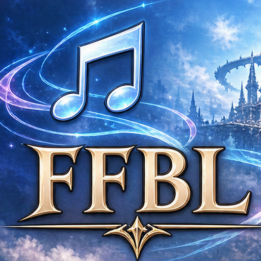
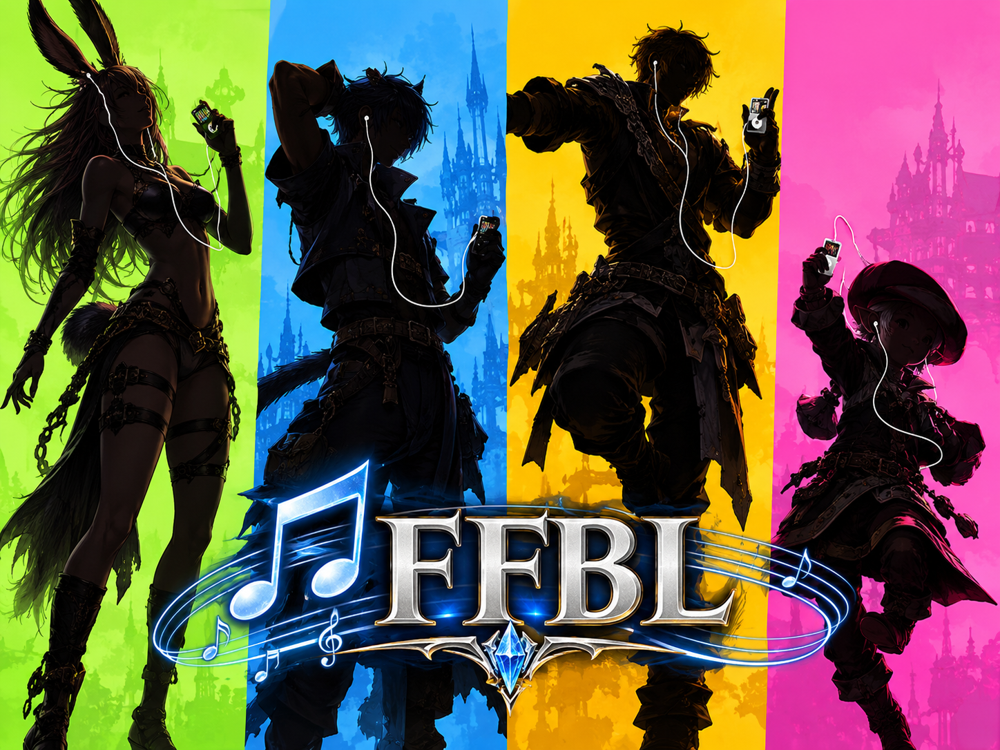

<div align="center">



# FFBL

**A caixa de som do seu grupo de RP, dentro do Final Fantasy XIV.**

🇧🇷 **Português** · [🇺🇸 English](README.en.md) · [🇯🇵 日本語](README.ja.md) · [🇩🇪 Deutsch](README.de.md) · [🇫🇷 Français](README.fr.md)




</div>

---

## 🎵 O que é o FFBL?

O **FFBL** (uma paródia carinhosa de "JBL") transforma a sala de voz do seu Discord em uma **caixa de som compartilhada**. Qualquer pessoa do grupo pode **pedir, pular e pausar músicas sem sair do jogo**, por um **iPod** que aparece na tela, e a música toca para todo mundo na sala de voz.

### 🎭 Feito para RP, com jogadores vanilla e com mods

| Quem | O que vive |
|---|---|
| 🎧 **Jogador vanilla** (sem plugins) | Só entra na sala de voz do Discord e **escuta a música**, como em qualquer festa. Não precisa instalar nada. |
| 🛠️ **Jogador com o FFBL** | Tem o **iPod no jogo**: pede músicas, pula, pausa, muda o volume e vê a **música atual** e a **fila**. |
| 📺 **Jogador com o FFBL + Penumbra** | Também vê o **telão**, uma tela de verdade no cenário (usa o seu minion *Plush Cushion*), mostrando a capa da música ou uma imagem sua. |

Assim a cena de RP funciona para todo mundo: quem tem mods enxerga mais, e quem joga puro escuta a mesma música.

## ✨ O que ele faz

- 📱 **iPod no jogo** com roda de clique: ⏮ ⏭ ⏯, volume e playlist.
- 💬 **Pedidos com o nome do seu personagem**: o que você pede aparece na sala do Discord com o nome do seu personagem.
- 🎶 **Fila compartilhada**: peça por nome ou link do YouTube.
- 📺 **Telão no cenário**: imagem padrão, capa da música atual ou uma imagem sua. Dá para mudar tamanho, posição e giro.
- 🌍 **Português, English, 日本語, Deutsch e Français.**
- 🔌 **OMNE incluído** (voz por proximidade, veja abaixo).

## 🗣️ O que é o OMNE?

O **OMNE** (*Olá, Meu Nome É*) é a parte do FFBL que cria **voz por proximidade usando uma sala de voz do Discord**: quanto mais perto o personagem de alguém está do seu, **mais alto você ouve essa pessoa**; ao se afastar, a voz some aos poucos.

**Como funciona, em palavras simples:**

1. Todo mundo entra na mesma sala de voz do Discord.
2. Você diz ao plugin qual personagem é cada pessoa da sala (botões **Eu** e **Alvo** ajudam).
3. Cinco vezes por segundo, o plugin mede a distância entre os personagens no jogo e ajusta o volume de cada pessoa **no seu Discord**.
4. Perto = volume cheio. Longe = silêncio. Você escolhe as distâncias.

**É seguro?** O OMNE **não grava, não captura e não envia áudio**. Ele só conversa com o Discord instalado no seu próprio computador e muda o volume de cada pessoa. Não existe servidor do OMNE.

> ℹ️ Por padrão o OMNE vem **desligado** (aba **OMNE** do plugin, caixa "Ativar o OMNE").
> O controle de volume do Discord é um recurso restrito: só funciona para quem foi adicionado como *testador do app* (limite de 50 pessoas por app).

## 🚀 Quero usar! (jogadores)

👉 **[Guia do jogador](docs/usuarios.md)**: instalar o plugin em poucos cliques e conectar.

Resumo: no Dalamud, `/xlsettings` → **Experimental** → **Repositórios personalizados**, cole este endereço e instale o FFBL:

```
https://raw.githubusercontent.com/yurammaruy/FFBL/main/repo.json
```

Quem organiza o grupo vai te passar um **código de conexão** (começa com `FFBL1-`). Você cola ele no FFBL e tudo é preenchido sozinho.

## 🏠 Quero montar na minha sala! (donos do canal)

👉 **[Guia do dono do canal](docs/donos.md)**: criar o app no Discord, ligar o bot de música e liberar o grupo.

O passo a passo cobre: configurar o Discord → instalar e ligar o bot → passar os dados para os jogadores.

## ⚠️ Avisos importantes

- Plugins do Dalamud **não são apoiados pela Square Enix**. Use por sua conta e risco.
- O **link do webhook funciona como uma senha**: só compartilhe com o seu grupo.
- O telão precisa do plugin **Penumbra** e do minion **Plush Cushion**.
- Não é possível transmitir a tela do telão pelo Discord (a política do Discord restringe isso em alguns países), por isso o telão mostra imagens, e o som sai pela sala de voz.

## 🤝 Contribuir e licença

Projeto **open source** (licença [MIT](LICENSE)). Sugestões, correções e traduções são bem-vindas em **Issues** e **Pull Requests**.

O telão usa o mod **Background Screen**, de **Anya Hichu** (incluído em `penumbra/` com os devidos créditos).

Feito por **Lusmar**, com muito carinho pela comunidade de RP de Eorzea. 💙
